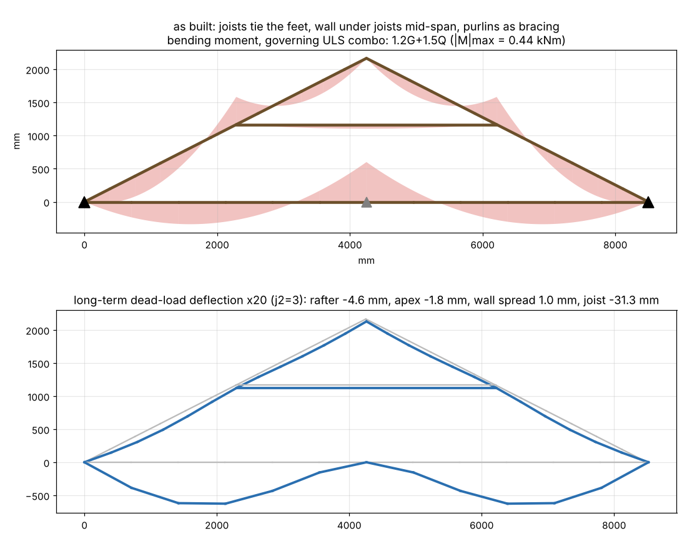
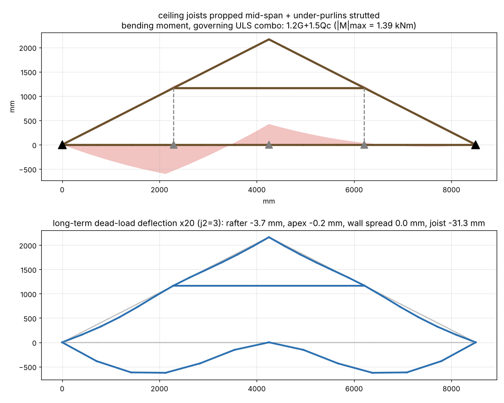
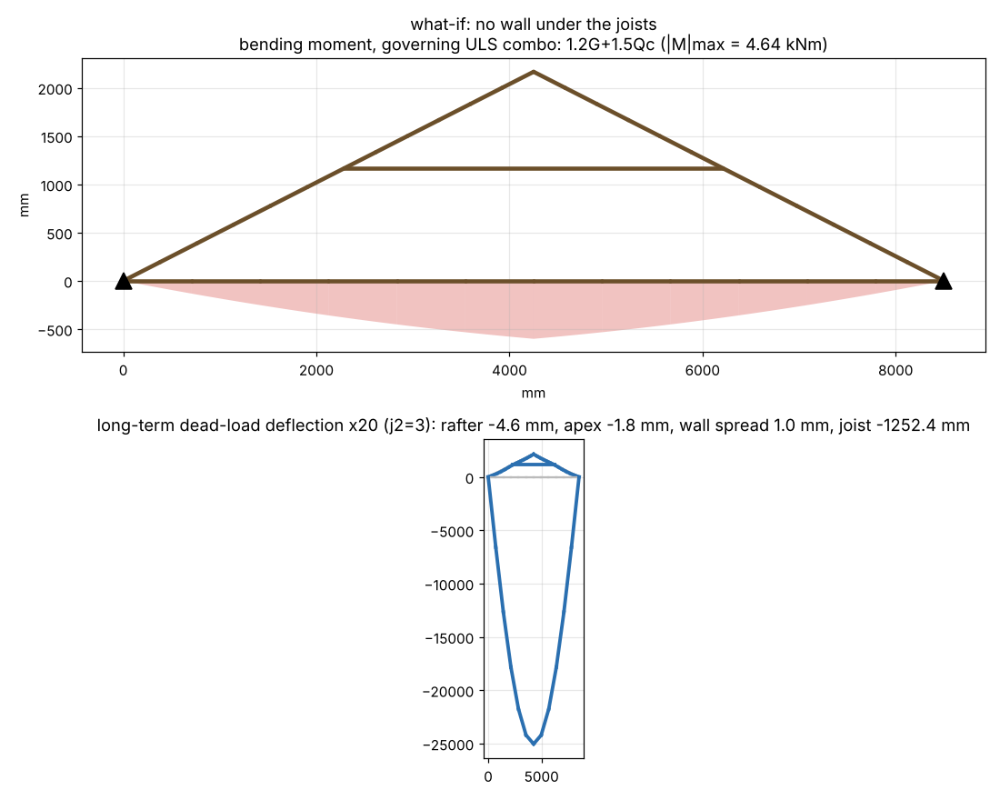
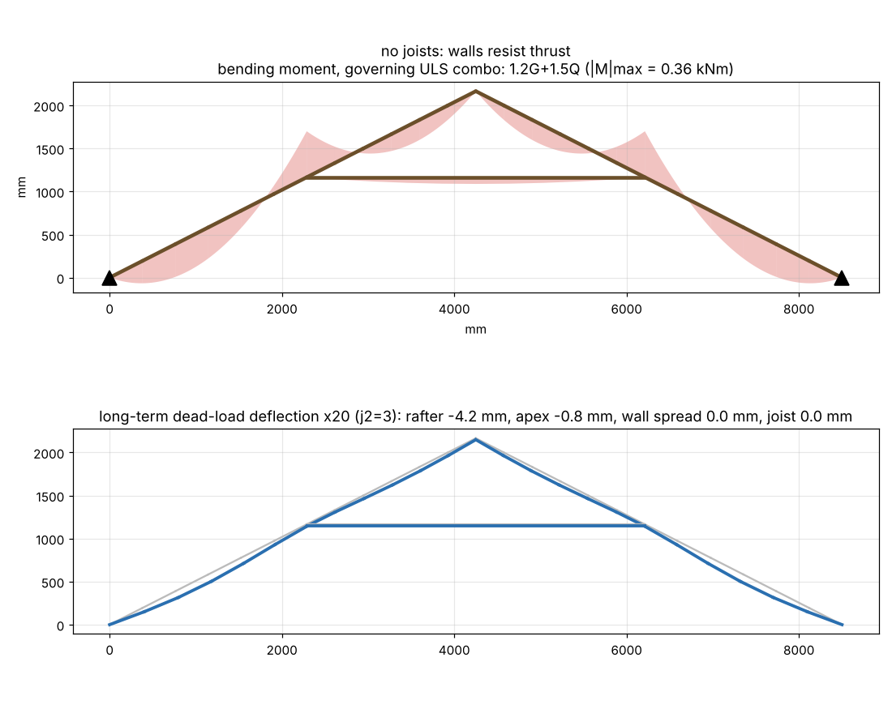
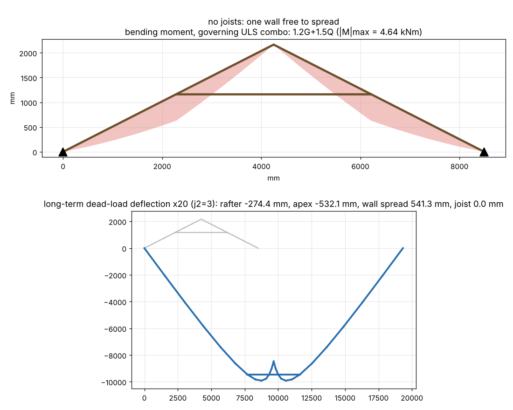

# Roof truss analysis — span 8500 mm, pitch 27°, 35x105 F7 Oregon, trusses @ 1200 c/c

Geometry: rise 2165 mm, rafter 4770 mm on slope (wall→collar 2567, collar→apex 2203), collar tie 3925 mm long at 1165 mm above the plate.

### as built: joists tie the feet, wall under joists mid-span, purlins as bracing — 35x105 F7, span 8500, pitch 27°, trusses @ 1200 c/c

Governing utilisation per member (ULS, demand/capacity; >1.0 = FAIL):

| group | combo | tag | util | M* kNm | Md kNm | N* kN | Ncx kN | Ncy kN | Nt kN | k12b | k12cy |
|---|---|---|---|---|---|---|---|---|---|---|---|
| collar | 1.2G+1.5Q | collar tie | 7.97 | 0.05 | 0.39 | -3.40 | 3.84 | 0.43 | 26.60 | 0.51 | 0.01 |
| tie | 1.2G+1.5Qc | ceiling joist | 3.79 | 1.39 | 0.37 | 1.33 | 3.38 | 26.09 | 27.45 | 0.47 | 0.80 |
| rafter | 1.2G+Wa | rafter R lower | 2.68 | -1.61 | 0.62 | -1.09 | 14.32 | 12.95 | 28.30 | 0.76 | 0.39 |

Support reactions per truss (kN; H = horizontal thrust the wall must resist):

| support | |H| max | V max (down) | V min (uplift if <0) |
|---|---|---|---|
| joist prop 1 | 0.00 | 1.97 | 0.78 |
| wall L | 2.44 | 3.35 | -2.09 |
| wall R | 0.00 | 3.35 | -2.09 |

Serviceability deflections (mm; rafter limit span/300 = 15.9 mm on the 4770 mm slope length, lower segment 8.6 mm, ceiling joist span 4250 mm → 14.2 mm):

| case | j2 | rafter_mm | lower_seg_mm | apex_mm | spread_mm | collar_shorten_mm | collar_sag_mm | joist_sag_mm |
|---|---|---|---|---|---|---|---|---|
| G long-term | 3 | -4.56 | -3.99 | -1.80 | 0.97 | -0.36 | -6.89 | -31.31 |
| 0.7Q short-term | 1 | -2.00 | -1.77 | -0.75 | 0.40 | -0.15 | 0.00 | 0.00 |
| Ws uplift | 1 | 4.73 | 4.26 | 1.39 | -0.72 | 0.36 | 0.00 | 0.00 |

Collar-tie lap connection: N* = 4.44 kN (compression, 1.2G+Wd). With 3.15 mm nails in J4 Oregon (Q_k ≈ 0.515 kN, φ = 0.80, k1 = 1.0, k17 = 0.88) that is ≈ 13 nails each end; or design an M12 bolt + washers.

### what-if: same + under-purlins strutted down to a wall/beam — 35x105 F7, span 8500, pitch 27°, trusses @ 1200 c/c

Governing utilisation per member (ULS, demand/capacity; >1.0 = FAIL):

| group | combo | tag | util | M* kNm | Md kNm | N* kN | Ncx kN | Ncy kN | Nt kN | k12b | k12cy |
|---|---|---|---|---|---|---|---|---|---|---|---|
| tie | 1.2G+1.5Qc | ceiling joist | 3.74 | 1.39 | 0.37 | 0.06 | 3.38 | 26.09 | 27.45 | 0.47 | 0.80 |
| rafter | 1.2G+1.5Qp | rafter L lower | 1.35 | 1.03 | 0.79 | -0.39 | 9.27 | 8.38 | 27.45 | 1.00 | 0.26 |
| collar | 1.35G | collar tie | 0.23 | 0.05 | 0.24 | 0.22 | 2.33 | 0.26 | 16.13 | 0.51 | 0.01 |

Support reactions per truss (kN; H = horizontal thrust the wall must resist):

| support | |H| max | V max (down) | V min (uplift if <0) |
|---|---|---|---|
| joist prop 1 | 0.00 | 1.97 | 0.78 |
| strut L | 0.00 | 2.40 | -1.78 |
| strut R | 0.00 | 2.33 | -1.78 |
| wall L | 2.44 | 1.33 | -0.31 |
| wall R | 0.00 | 1.02 | -0.31 |

Serviceability deflections (mm; rafter limit span/300 = 15.9 mm on the 4770 mm slope length, lower segment 8.6 mm, ceiling joist span 4250 mm → 14.2 mm):

| case | j2 | rafter_mm | lower_seg_mm | apex_mm | spread_mm | collar_shorten_mm | collar_sag_mm | joist_sag_mm |
|---|---|---|---|---|---|---|---|---|
| G long-term | 3 | -3.67 | -3.73 | -0.19 | 0.04 | 0.07 | -6.89 | -31.31 |
| 0.7Q short-term | 1 | -1.64 | -1.66 | -0.09 | 0.02 | 0.03 | 0.00 | 0.00 |
| Ws uplift | 1 | 4.02 | 4.04 | 0.09 | 0.03 | 0.01 | 0.00 | 0.00 |

Collar-tie lap connection: N* = 0.77 kN (tension, 1.2G+Wa). With 3.15 mm nails in J4 Oregon (Q_k ≈ 0.515 kN, φ = 0.80, k1 = 1.0, k17 = 1.0) that is ≈ 2 nails each end; or design an M12 bolt + washers.

### what-if: no wall under the joists — 35x105 F7, span 8500, pitch 27°, trusses @ 1200 c/c

Governing utilisation per member (ULS, demand/capacity; >1.0 = FAIL):

| group | combo | tag | util | M* kNm | Md kNm | N* kN | Ncx kN | Ncy kN | Nt kN | k12b | k12cy |
|---|---|---|---|---|---|---|---|---|---|---|---|
| tie | 1.2G+1.5Qc | ceiling joist | 25.10 | 4.64 | 0.19 | 1.33 | 0.85 | 26.09 | 27.45 | 0.24 | 0.80 |
| collar | 1.2G+1.5Q | collar tie | 7.97 | 0.05 | 0.39 | -3.40 | 3.84 | 0.43 | 26.60 | 0.51 | 0.01 |
| rafter | 1.2G+Wa | rafter R lower | 2.68 | -1.61 | 0.62 | -1.09 | 14.32 | 12.95 | 28.30 | 0.76 | 0.39 |

Support reactions per truss (kN; H = horizontal thrust the wall must resist):

| support | |H| max | V max (down) | V min (uplift if <0) |
|---|---|---|---|
| wall L | 2.44 | 3.88 | -1.70 |
| wall R | 0.00 | 3.88 | -1.70 |

Serviceability deflections (mm; rafter limit span/300 = 15.9 mm on the 4770 mm slope length, lower segment 8.6 mm, ceiling joist span 8500 mm → 28.3 mm):

| case | j2 | rafter_mm | lower_seg_mm | apex_mm | spread_mm | collar_shorten_mm | collar_sag_mm | joist_sag_mm |
|---|---|---|---|---|---|---|---|---|
| G long-term | 3 | -4.56 | -3.99 | -1.80 | 0.97 | -0.36 | -6.89 | -1252.40 |
| 0.7Q short-term | 1 | -2.00 | -1.77 | -0.75 | 0.40 | -0.15 | 0.00 | 0.00 |
| Ws uplift | 1 | 4.73 | 4.26 | 1.39 | -0.72 | 0.36 | 0.00 | 0.00 |

Collar-tie lap connection: N* = 4.44 kN (compression, 1.2G+Wd). With 3.15 mm nails in J4 Oregon (Q_k ≈ 0.515 kN, φ = 0.80, k1 = 1.0, k17 = 0.88) that is ≈ 13 nails each end; or design an M12 bolt + washers.

### no joists: walls resist thrust — 35x105 F7, span 8500, pitch 27°, trusses @ 1200 c/c

Governing utilisation per member (ULS, demand/capacity; >1.0 = FAIL):

| group | combo | tag | util | M* kNm | Md kNm | N* kN | Ncx kN | Ncy kN | Nt kN | k12b | k12cy |
|---|---|---|---|---|---|---|---|---|---|---|---|
| collar | 1.2G+1.5Q | collar tie | 8.01 | 0.05 | 0.39 | -3.41 | 3.84 | 0.43 | 26.60 | 0.51 | 0.01 |
| rafter | 1.2G+Wa | rafter R lower | 2.69 | -1.61 | 0.62 | -1.09 | 14.32 | 12.95 | 28.30 | 0.76 | 0.39 |

Support reactions per truss (kN; H = horizontal thrust the wall must resist):

| support | |H| max | V max (down) | V min (uplift if <0) |
|---|---|---|---|
| wall L | 4.49 | 3.04 | -2.32 |
| wall R | 4.49 | 3.04 | -2.32 |

Serviceability deflections (mm; rafter limit span/300 = 15.9 mm on the 4770 mm slope length, lower segment 8.6 mm):

| case | j2 | rafter_mm | lower_seg_mm | apex_mm | spread_mm | collar_shorten_mm | collar_sag_mm | joist_sag_mm |
|---|---|---|---|---|---|---|---|---|
| G long-term | 3 | -4.20 | -3.89 | -0.85 | 0.00 | -0.36 | -6.89 | 0.00 |
| 0.7Q short-term | 1 | -1.86 | -1.73 | -0.36 | 0.00 | -0.15 | 0.00 | 0.00 |
| Ws uplift | 1 | 4.47 | 4.18 | 0.68 | 0.00 | 0.36 | 0.00 | 0.00 |

Collar-tie lap connection: N* = 4.46 kN (compression, 1.2G+Wd). With 3.15 mm nails in J4 Oregon (Q_k ≈ 0.515 kN, φ = 0.80, k1 = 1.0, k17 = 0.88) that is ≈ 13 nails each end; or design an M12 bolt + washers.

### no joists: one wall free to spread — 35x105 F7, span 8500, pitch 27°, trusses @ 1200 c/c

Governing utilisation per member (ULS, demand/capacity; >1.0 = FAIL):

| group | combo | tag | util | M* kNm | Md kNm | N* kN | Ncx kN | Ncy kN | Nt kN | k12b | k12cy |
|---|---|---|---|---|---|---|---|---|---|---|---|
| rafter | 1.2G+1.5Q | rafter R upper | 6.81 | 4.64 | 0.76 | -5.80 | 12.20 | 8.12 | 26.60 | 1.00 | 0.26 |
| collar | 0.9G+Wu | collar tie | 4.85 | 0.03 | 0.48 | -3.30 | 6.13 | 0.68 | 28.30 | 0.59 | 0.02 |

Support reactions per truss (kN; H = horizontal thrust the wall must resist):

| support | |H| max | V max (down) | V min (uplift if <0) |
|---|---|---|---|
| wall L | 2.44 | 3.04 | -2.32 |
| wall R | 0.00 | 3.04 | -2.32 |

Serviceability deflections (mm; rafter limit span/300 = 15.9 mm on the 4770 mm slope length, lower segment 8.6 mm):

| case | j2 | rafter_mm | lower_seg_mm | apex_mm | spread_mm | collar_shorten_mm | collar_sag_mm | joist_sag_mm |
|---|---|---|---|---|---|---|---|---|
| G long-term | 3 | -274.37 | -63.71 | -532.07 | 541.35 | 0.61 | -6.89 | 0.00 |
| 0.7Q short-term | 1 | -113.96 | -26.58 | -221.02 | 224.87 | 0.26 | 0.00 | 0.00 |
| Ws uplift | 1 | 203.95 | 48.62 | 395.35 | -402.18 | -0.36 | 0.00 | 0.00 |

Collar-tie lap connection: N* = 5.87 kN (tension, 1.2G+1.5Q). With 3.15 mm nails in J4 Oregon (Q_k ≈ 0.515 kN, φ = 0.80, k1 = 0.94, k17 = 0.8) that is ≈ 19 nails each end; or design an M12 bolt + washers.

### Section sweep — joists propped mid-span, purlins NOT strutted

| section | rafter util | rafter combo | collar util | joist util | rafter δG mm | joist δG mm | H wall kN |
|---|---|---|---|---|---|---|---|
| 35x105 | 2.68 | 1.2G+Wa | 7.97 | 3.79 | 4.56 | 31.31 | 2.44 |
| 35x140 | 1.78 | 1.2G+Wa | 6.07 | 2.86 | 2.30 | 13.74 | 2.44 |
| 45x140 | 1.07 | 1.2G+Wa | 2.92 | 1.39 | 1.89 | 11.16 | 2.44 |
| 35x190 | 1.24 | 1.2G+Wa | 4.54 | 2.13 | 1.22 | 5.80 | 2.44 |
| 45x190 | 0.67 | 1.2G+Wa | 2.20 | 1.02 | 1.02 | 4.77 | 2.44 |
| 45x240 | 0.48 | 1.2G+Wa | 1.77 | 0.82 | 0.69 | 2.52 | 2.44 | 

### Section sweep — joists propped mid-span + purlins strutted

| section | rafter util | rafter combo | collar util | joist util | rafter δG mm | joist δG mm | H wall kN |
|---|---|---|---|---|---|---|---|
| 35x105 | 1.35 | 1.2G+1.5Qp | 0.23 | 3.74 | 3.67 | 31.31 | 2.44 |
| 35x140 | 0.79 | 1.2G+1.5Qp | 0.23 | 2.83 | 1.60 | 13.74 | 2.44 |
| 45x140 | 0.59 | 1.2G+1.5Qp | 0.15 | 1.36 | 1.31 | 11.16 | 2.44 |
| 35x190 | 0.56 | 1.2G+1.5Qp | 0.23 | 2.10 | 0.66 | 5.80 | 2.44 |
| 45x190 | 0.32 | 1.2G+1.5Qp | 0.14 | 1.00 | 0.55 | 4.77 | 2.44 |
| 45x240 | 0.22 | 1.2G+1.5Qp | 0.14 | 0.80 | 0.28 | 2.52 | 2.44 | 

