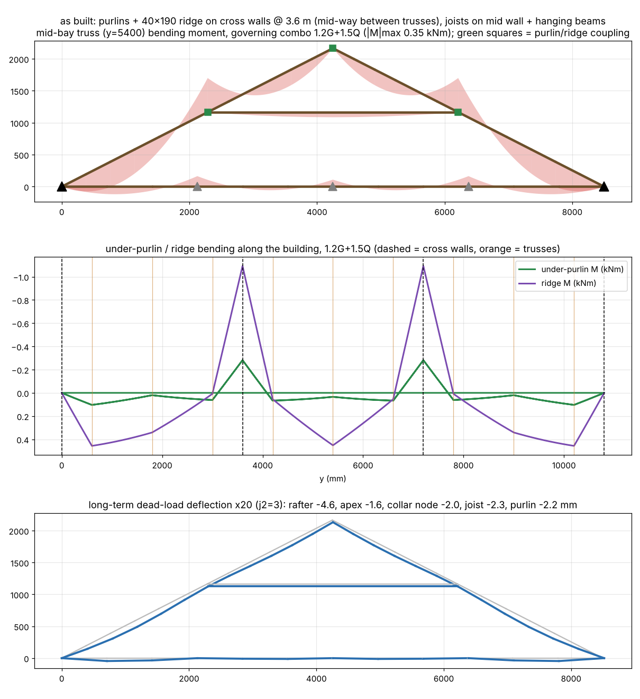
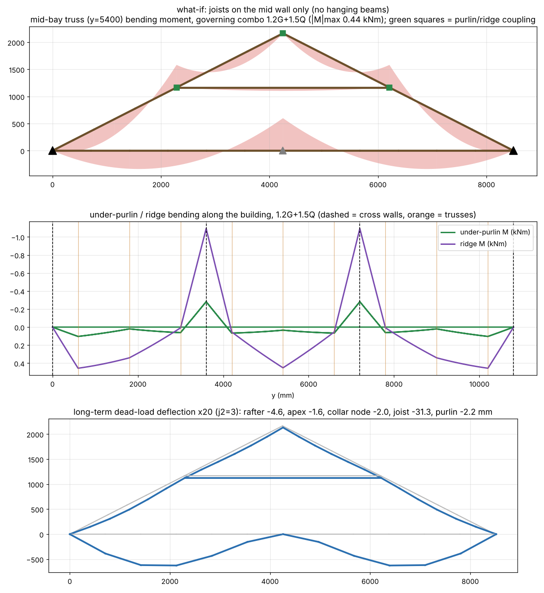
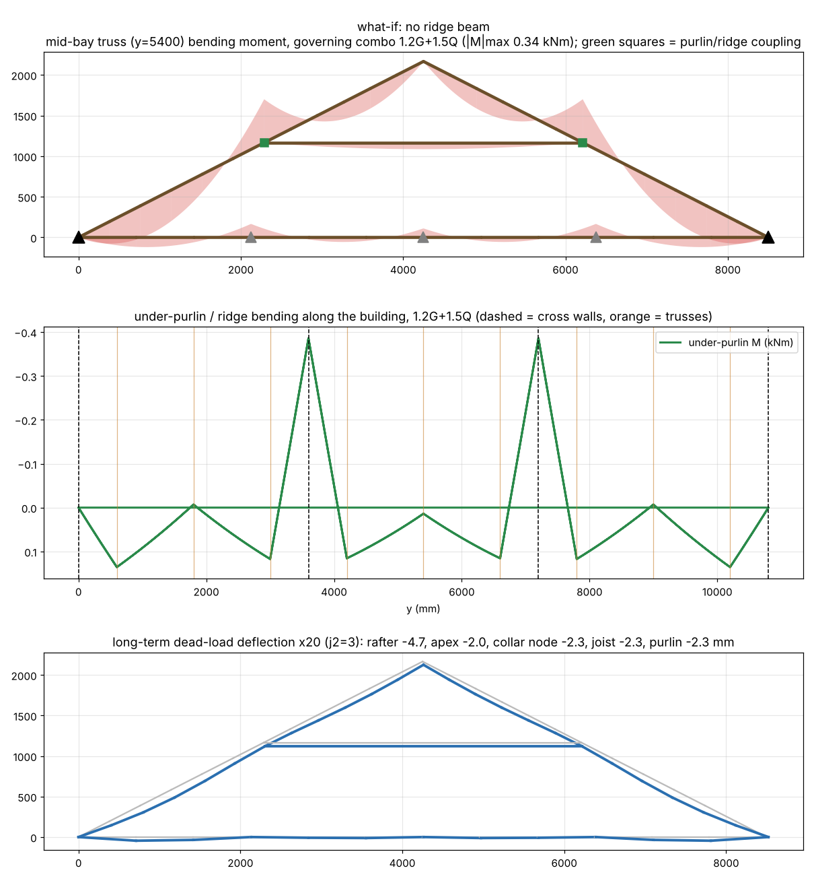
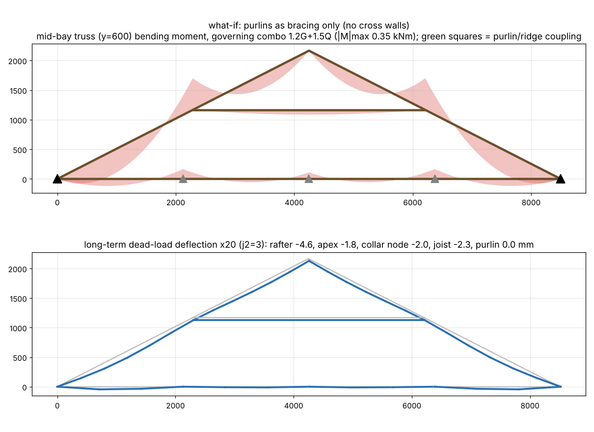
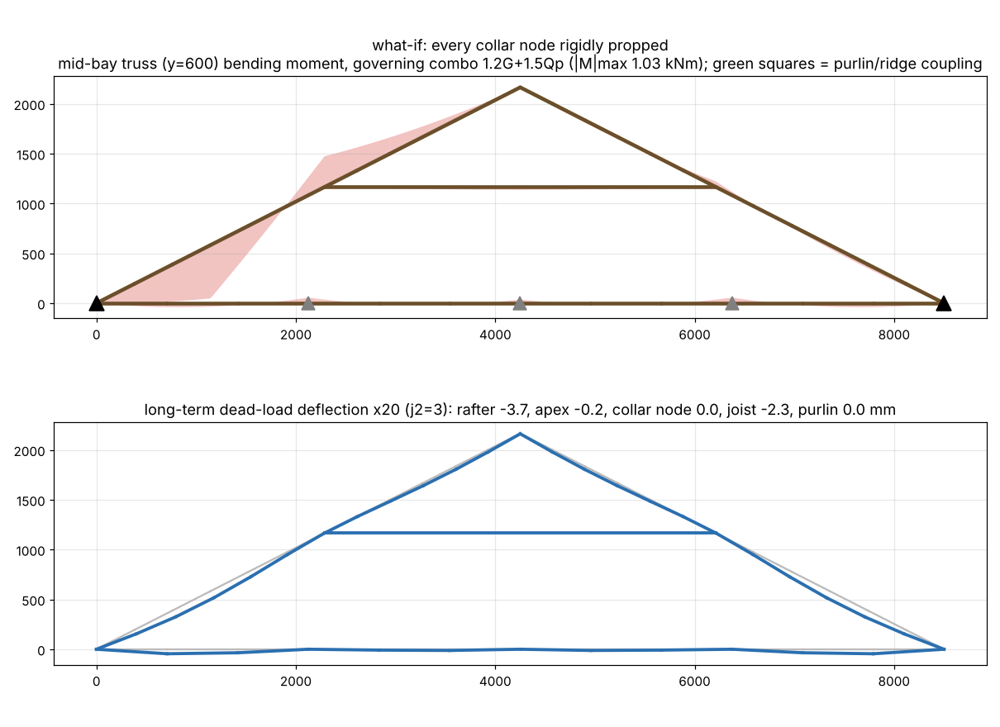
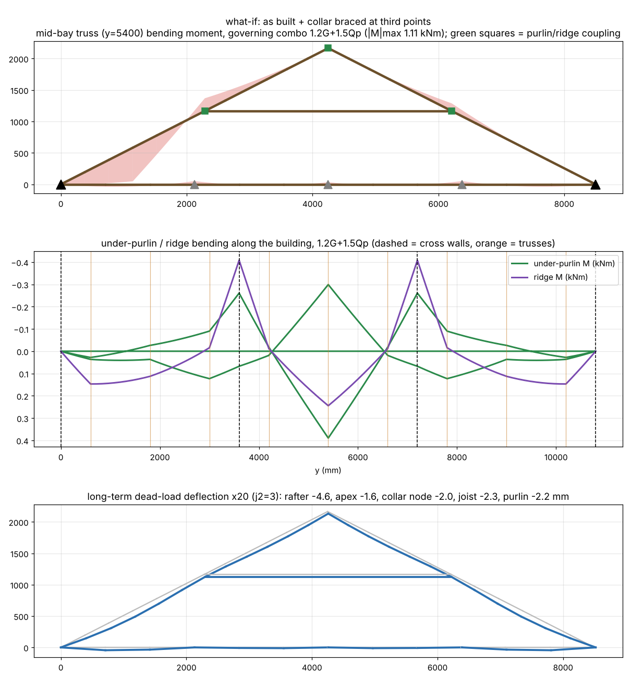

# Roof analysis — span 8500 mm, pitch 27°, 35x105 F7 Oregon, trusses @ 1200 c/c

Geometry: rise 2165 mm, rafter 4770 on slope (wall→collar 2567, collar→apex 2203), collar 3925 long at 1165 above the plate; 9 trusses modelled over 3 x 3600 mm bays, results for truss at y=5400.

### as built: purlins + 40x190 ridge on cross walls @ 3.6 m (mid-way between trusses), joists on mid wall + hanging beams — 35x105 F7, ridge (40, 190), span 8500, pitch 27°, trusses @ 1200 c/c, cross walls @ 3600

Governing utilisation per member (ULS, demand/capacity; >1.0 = FAIL):

| group | combo | tag | util | M* kNm | Md kNm | N* kN | Ncx kN | Ncy kN | Nt kN | k12b | k12cy |
|---|---|---|---|---|---|---|---|---|---|---|---|
| collar | 1.2G+1.5Q | collar tie | 8.58 | 0.05 | 0.39 | -3.66 | 3.84 | 0.43 | 26.60 | 0.51 | 0.01 |
| purlin | 1.2G+Wa | under-purlin L | 3.69 | -1.88 | 0.51 | 0.00 | 7.28 | 7.28 | 28.30 | 0.63 | 0.22 |
| rafter | 1.2G+1.5Qp | rafter L lower | 1.75 | 1.11 | 0.79 | -2.76 | 9.27 | 8.38 | 27.45 | 1.00 | 0.26 |
| tie | 1.2G+1.5Qc | ceiling joist | 1.08 | 0.63 | 0.61 | 1.26 | 13.53 | 26.09 | 27.45 | 0.77 | 0.80 |
| ridge | 1.2G+1.5Q | ridge beam | 0.95 | -1.09 | 1.15 | 0.00 | 30.92 | 12.34 | 55.01 | 0.40 | 0.19 |

Support reactions (kN; H = horizontal thrust):

| support | |H| max | V max (down) | V min (uplift if <0) |
|---|---|---|---|
| joist prop 1 (mid truss) | 0.00 | 1.17 | 0.36 |
| joist prop 2 (mid truss) | 0.00 | 0.44 | 0.22 |
| joist prop 3 (mid truss) | 0.00 | 0.54 | 0.36 |
| purlin on cross wall (L y=0) | 0.00 | 1.67 | -0.15 |
| purlin on cross wall (L y=10800) | 0.00 | 1.67 | -0.15 |
| purlin on cross wall (L y=3600) | 0.00 | 5.72 | -1.01 |
| purlin on cross wall (L y=7200) | 0.00 | 5.72 | -1.01 |
| purlin on cross wall (R y=0) | 0.00 | 0.20 | -1.59 |
| purlin on cross wall (R y=10800) | 0.00 | 0.20 | -1.59 |
| purlin on cross wall (R y=3600) | 0.00 | 1.35 | -5.27 |
| purlin on cross wall (R y=7200) | 0.00 | 1.35 | -5.27 |
| ridge on cross wall (y=0) | 0.00 | 0.82 | -0.57 |
| ridge on cross wall (y=10800) | 0.00 | 0.82 | -0.57 |
| ridge on cross wall (y=3600) | 0.00 | 3.94 | -2.70 |
| ridge on cross wall (y=7200) | 0.00 | 3.94 | -2.70 |
| wall L (mid truss) | 2.44 | 2.97 | -1.95 |
| wall R (mid truss) | 0.00 | 2.97 | -1.95 |

Serviceability deflections, mid-bay truss (mm; limits span/300: rafter 15.9, joist span 2125 → 7.1, purlin bay 3600 → 12.0):

| case | j2 | rafter_mm | lower_seg_mm | collar_node_mm | apex_mm | spread_mm | joist_sag_mm | purlin_mm |
|---|---|---|---|---|---|---|---|---|
| G long-term | 3 | -4.58 | -4.00 | -1.97 | -1.65 | 0.92 | -2.26 | -2.22 |
| 0.7Q short-term | 1 | -1.99 | -1.77 | -0.76 | -0.63 | 0.35 | 0.00 | -0.85 |
| Ws uplift | 1 | 4.71 | 4.25 | 1.49 | 1.16 | -0.63 | 0.00 | 1.67 |

Collar-tie lap: N* = 4.74 kN (compression, 1.2G+Wd) ≈ 15 x 3.15 mm nails each end (Q_k 0.515 kN J4, φ 0.80, k1 1.0, k17 0.8), or an M12 bolt.

### what-if: joists on the mid wall only (no hanging beams) — 35x105 F7, ridge (40, 190), span 8500, pitch 27°, trusses @ 1200 c/c, cross walls @ 3600

Governing utilisation per member (ULS, demand/capacity; >1.0 = FAIL):

| group | combo | tag | util | M* kNm | Md kNm | N* kN | Ncx kN | Ncy kN | Nt kN | k12b | k12cy |
|---|---|---|---|---|---|---|---|---|---|---|---|
| collar | 1.2G+1.5Q | collar tie | 8.58 | 0.05 | 0.39 | -3.66 | 3.84 | 0.43 | 26.60 | 0.51 | 0.01 |
| tie | 1.2G+1.5Qc | ceiling joist | 3.79 | 1.39 | 0.37 | 1.26 | 3.38 | 26.09 | 27.45 | 0.47 | 0.80 |
| purlin | 1.2G+Wa | under-purlin L | 3.69 | -1.88 | 0.51 | 0.00 | 7.28 | 7.28 | 28.30 | 0.63 | 0.22 |
| rafter | 1.2G+1.5Qp | rafter L lower | 1.75 | 1.11 | 0.79 | -2.76 | 9.27 | 8.38 | 27.45 | 1.00 | 0.26 |
| ridge | 1.2G+1.5Q | ridge beam | 0.95 | -1.09 | 1.15 | 0.00 | 30.92 | 12.34 | 55.01 | 0.40 | 0.19 |

Support reactions (kN; H = horizontal thrust):

| support | |H| max | V max (down) | V min (uplift if <0) |
|---|---|---|---|
| joist prop 1 (mid truss) | 0.00 | 1.97 | 0.78 |
| purlin on cross wall (L y=0) | 0.00 | 1.67 | -0.15 |
| purlin on cross wall (L y=10800) | 0.00 | 1.67 | -0.15 |
| purlin on cross wall (L y=3600) | 0.00 | 5.72 | -1.01 |
| purlin on cross wall (L y=7200) | 0.00 | 5.72 | -1.01 |
| purlin on cross wall (R y=0) | 0.00 | 0.20 | -1.59 |
| purlin on cross wall (R y=10800) | 0.00 | 0.20 | -1.59 |
| purlin on cross wall (R y=3600) | 0.00 | 1.35 | -5.27 |
| purlin on cross wall (R y=7200) | 0.00 | 1.35 | -5.27 |
| ridge on cross wall (y=0) | 0.00 | 0.82 | -0.57 |
| ridge on cross wall (y=10800) | 0.00 | 0.82 | -0.57 |
| ridge on cross wall (y=3600) | 0.00 | 3.94 | -2.70 |
| ridge on cross wall (y=7200) | 0.00 | 3.94 | -2.70 |
| wall L (mid truss) | 2.44 | 3.12 | -1.84 |
| wall R (mid truss) | 0.00 | 3.12 | -1.84 |

Serviceability deflections, mid-bay truss (mm; limits span/300: rafter 15.9, joist span 4250 → 14.2, purlin bay 3600 → 12.0):

| case | j2 | rafter_mm | lower_seg_mm | collar_node_mm | apex_mm | spread_mm | joist_sag_mm | purlin_mm |
|---|---|---|---|---|---|---|---|---|
| G long-term | 3 | -4.58 | -4.00 | -1.97 | -1.65 | 0.92 | -31.31 | -2.22 |
| 0.7Q short-term | 1 | -1.99 | -1.77 | -0.76 | -0.63 | 0.35 | 0.00 | -0.85 |
| Ws uplift | 1 | 4.71 | 4.25 | 1.49 | 1.16 | -0.63 | 0.00 | 1.67 |

Collar-tie lap: N* = 4.74 kN (compression, 1.2G+Wd) ≈ 15 x 3.15 mm nails each end (Q_k 0.515 kN J4, φ 0.80, k1 1.0, k17 0.8), or an M12 bolt.

### what-if: no ridge beam — 35x105 F7, ridge none, span 8500, pitch 27°, trusses @ 1200 c/c, cross walls @ 3600

Governing utilisation per member (ULS, demand/capacity; >1.0 = FAIL):

| group | combo | tag | util | M* kNm | Md kNm | N* kN | Ncx kN | Ncy kN | Nt kN | k12b | k12cy |
|---|---|---|---|---|---|---|---|---|---|---|---|
| collar | 1.2G+1.5Q | collar tie | 9.12 | 0.05 | 0.39 | -3.88 | 3.84 | 0.43 | 26.60 | 0.51 | 0.01 |
| purlin | 1.2G+Wa | under-purlin L | 3.75 | -1.91 | 0.51 | 0.00 | 7.28 | 7.28 | 28.30 | 0.63 | 0.22 |
| rafter | 1.2G+1.5Qp | rafter L lower | 1.80 | 1.11 | 0.79 | -3.20 | 9.27 | 8.38 | 27.45 | 1.00 | 0.26 |
| tie | 1.2G+1.5Qc | ceiling joist | 1.09 | 0.63 | 0.61 | 1.49 | 13.53 | 26.09 | 27.45 | 0.77 | 0.80 |

Support reactions (kN; H = horizontal thrust):

| support | |H| max | V max (down) | V min (uplift if <0) |
|---|---|---|---|
| joist prop 1 (mid truss) | 0.00 | 1.17 | 0.36 |
| joist prop 2 (mid truss) | 0.00 | 0.44 | 0.22 |
| joist prop 3 (mid truss) | 0.00 | 0.54 | 0.36 |
| purlin on cross wall (L y=0) | 0.00 | 1.69 | -0.19 |
| purlin on cross wall (L y=10800) | 0.00 | 1.69 | -0.19 |
| purlin on cross wall (L y=3600) | 0.00 | 5.87 | -1.40 |
| purlin on cross wall (L y=7200) | 0.00 | 5.87 | -1.40 |
| purlin on cross wall (R y=0) | 0.00 | 0.26 | -1.58 |
| purlin on cross wall (R y=10800) | 0.00 | 0.26 | -1.58 |
| purlin on cross wall (R y=3600) | 0.00 | 1.88 | -5.16 |
| purlin on cross wall (R y=7200) | 0.00 | 1.88 | -5.16 |
| wall L (mid truss) | 2.44 | 3.42 | -2.32 |
| wall R (mid truss) | 0.00 | 3.42 | -2.32 |

Serviceability deflections, mid-bay truss (mm; limits span/300: rafter 15.9, joist span 2125 → 7.1, purlin bay 3600 → 12.0):

| case | j2 | rafter_mm | lower_seg_mm | collar_node_mm | apex_mm | spread_mm | joist_sag_mm | purlin_mm |
|---|---|---|---|---|---|---|---|---|
| G long-term | 3 | -4.67 | -4.03 | -2.28 | -2.01 | 1.09 | -2.26 | -2.33 |
| 0.7Q short-term | 1 | -2.03 | -1.78 | -0.90 | -0.80 | 0.43 | 0.00 | -0.92 |
| Ws uplift | 1 | 4.79 | 4.27 | 1.77 | 1.50 | -0.78 | 0.00 | 1.81 |

Collar-tie lap: N* = 4.98 kN (compression, 1.2G+Wd) ≈ 16 x 3.15 mm nails each end (Q_k 0.515 kN J4, φ 0.80, k1 1.0, k17 0.8), or an M12 bolt.

### what-if: purlins as bracing only (no cross walls) — 35x105 F7, ridge (40, 190), span 8500, pitch 27°, trusses @ 1200 c/c, cross walls @ 0

Governing utilisation per member (ULS, demand/capacity; >1.0 = FAIL):

| group | combo | tag | util | M* kNm | Md kNm | N* kN | Ncx kN | Ncy kN | Nt kN | k12b | k12cy |
|---|---|---|---|---|---|---|---|---|---|---|---|
| collar | 1.2G+1.5Q | collar tie | 7.97 | 0.05 | 0.39 | -3.40 | 3.84 | 0.43 | 26.60 | 0.51 | 0.01 |
| rafter | 1.2G+Wa | rafter R lower | 2.68 | -1.61 | 0.62 | -1.09 | 14.32 | 12.95 | 28.30 | 0.76 | 0.39 |
| tie | 1.2G+1.5Qc | ceiling joist | 1.08 | 0.63 | 0.61 | 1.33 | 13.53 | 26.09 | 27.45 | 0.77 | 0.80 |

Support reactions (kN; H = horizontal thrust):

| support | |H| max | V max (down) | V min (uplift if <0) |
|---|---|---|---|
| joist prop 1 (mid truss) | 0.00 | 1.17 | 0.36 |
| joist prop 2 (mid truss) | 0.00 | 0.44 | 0.22 |
| joist prop 3 (mid truss) | 0.00 | 0.54 | 0.36 |
| wall L (mid truss) | 2.44 | 3.20 | -2.20 |
| wall R (mid truss) | 0.00 | 3.20 | -2.20 |

Serviceability deflections, mid-bay truss (mm; limits span/300: rafter 15.9, joist span 2125 → 7.1):

| case | j2 | rafter_mm | lower_seg_mm | collar_node_mm | apex_mm | spread_mm | joist_sag_mm | purlin_mm |
|---|---|---|---|---|---|---|---|---|
| G long-term | 3 | -4.56 | -3.99 | -2.02 | -1.80 | 0.97 | -2.26 | 0.00 |
| 0.7Q short-term | 1 | -2.00 | -1.77 | -0.84 | -0.75 | 0.40 | 0.00 | 0.00 |
| Ws uplift | 1 | 4.73 | 4.26 | 1.64 | 1.39 | -0.72 | 0.00 | 0.00 |

Collar-tie lap: N* = 4.44 kN (compression, 1.2G+Wd) ≈ 13 x 3.15 mm nails each end (Q_k 0.515 kN J4, φ 0.80, k1 1.0, k17 0.88), or an M12 bolt.

### what-if: every collar node rigidly propped — 35x105 F7, ridge (40, 190), span 8500, pitch 27°, trusses @ 1200 c/c, cross walls @ 0

Governing utilisation per member (ULS, demand/capacity; >1.0 = FAIL):

| group | combo | tag | util | M* kNm | Md kNm | N* kN | Ncx kN | Ncy kN | Nt kN | k12b | k12cy |
|---|---|---|---|---|---|---|---|---|---|---|---|
| rafter | 1.2G+1.5Qp | rafter L lower | 1.35 | 1.03 | 0.79 | -0.39 | 9.27 | 8.38 | 27.45 | 1.00 | 0.26 |
| tie | 1.2G+1.5Qc | ceiling joist | 1.04 | 0.63 | 0.61 | 0.06 | 13.53 | 26.09 | 27.45 | 0.77 | 0.80 |
| collar | 1.35G | collar tie | 0.23 | 0.05 | 0.24 | 0.22 | 2.33 | 0.26 | 16.13 | 0.51 | 0.01 |

Support reactions (kN; H = horizontal thrust):

| support | |H| max | V max (down) | V min (uplift if <0) |
|---|---|---|---|
| joist prop 1 (mid truss) | 0.00 | 1.17 | 0.36 |
| joist prop 2 (mid truss) | 0.00 | 0.44 | 0.22 |
| joist prop 3 (mid truss) | 0.00 | 0.54 | 0.36 |
| strut L (mid truss) | 0.00 | 2.40 | -1.78 |
| strut R (mid truss) | 0.00 | 2.33 | -1.78 |
| wall L (mid truss) | 2.44 | 1.18 | -0.42 |
| wall R (mid truss) | 0.00 | 0.88 | -0.42 |

Serviceability deflections, mid-bay truss (mm; limits span/300: rafter 15.9, joist span 2125 → 7.1):

| case | j2 | rafter_mm | lower_seg_mm | collar_node_mm | apex_mm | spread_mm | joist_sag_mm | purlin_mm |
|---|---|---|---|---|---|---|---|---|
| G long-term | 3 | -3.67 | -3.73 | 0.00 | -0.19 | 0.04 | -2.26 | 0.00 |
| 0.7Q short-term | 1 | -1.64 | -1.66 | 0.00 | -0.09 | 0.02 | 0.00 | 0.00 |
| Ws uplift | 1 | 4.02 | 4.04 | 0.00 | 0.09 | 0.03 | 0.00 | 0.00 |

Collar-tie lap: N* = 0.77 kN (tension, 1.2G+Wa) ≈ 2 x 3.15 mm nails each end (Q_k 0.515 kN J4, φ 0.80, k1 1.0, k17 1.0), or an M12 bolt.

### what-if: as built + collar braced at third points — 35x105 F7, ridge (40, 190), span 8500, pitch 27°, trusses @ 1200 c/c, cross walls @ 3600

Governing utilisation per member (ULS, demand/capacity; >1.0 = FAIL):

| group | combo | tag | util | M* kNm | Md kNm | N* kN | Ncx kN | Ncy kN | Nt kN | k12b | k12cy |
|---|---|---|---|---|---|---|---|---|---|---|---|
| purlin | 1.2G+Wa | under-purlin L | 3.69 | -1.88 | 0.51 | 0.00 | 7.28 | 7.28 | 28.30 | 0.63 | 0.22 |
| rafter | 1.2G+1.5Qp | rafter L lower | 1.75 | 1.11 | 0.79 | -2.76 | 9.27 | 8.38 | 27.45 | 1.00 | 0.26 |
| tie | 1.2G+1.5Qc | ceiling joist | 1.08 | 0.63 | 0.61 | 1.26 | 13.53 | 26.09 | 27.45 | 0.77 | 0.80 |
| collar | 1.2G+1.5Q | collar tie | 1.02 | 0.05 | 0.71 | -3.66 | 3.84 | 3.84 | 26.60 | 0.93 | 0.12 |
| ridge | 1.2G+1.5Q | ridge beam | 0.95 | -1.09 | 1.15 | 0.00 | 30.92 | 12.34 | 55.01 | 0.40 | 0.19 |

Support reactions (kN; H = horizontal thrust):

| support | |H| max | V max (down) | V min (uplift if <0) |
|---|---|---|---|
| joist prop 1 (mid truss) | 0.00 | 1.17 | 0.36 |
| joist prop 2 (mid truss) | 0.00 | 0.44 | 0.22 |
| joist prop 3 (mid truss) | 0.00 | 0.54 | 0.36 |
| purlin on cross wall (L y=0) | 0.00 | 1.67 | -0.15 |
| purlin on cross wall (L y=10800) | 0.00 | 1.67 | -0.15 |
| purlin on cross wall (L y=3600) | 0.00 | 5.72 | -1.01 |
| purlin on cross wall (L y=7200) | 0.00 | 5.72 | -1.01 |
| purlin on cross wall (R y=0) | 0.00 | 0.20 | -1.59 |
| purlin on cross wall (R y=10800) | 0.00 | 0.20 | -1.59 |
| purlin on cross wall (R y=3600) | 0.00 | 1.35 | -5.27 |
| purlin on cross wall (R y=7200) | 0.00 | 1.35 | -5.27 |
| ridge on cross wall (y=0) | 0.00 | 0.82 | -0.57 |
| ridge on cross wall (y=10800) | 0.00 | 0.82 | -0.57 |
| ridge on cross wall (y=3600) | 0.00 | 3.94 | -2.70 |
| ridge on cross wall (y=7200) | 0.00 | 3.94 | -2.70 |
| wall L (mid truss) | 2.44 | 2.97 | -1.95 |
| wall R (mid truss) | 0.00 | 2.97 | -1.95 |

Serviceability deflections, mid-bay truss (mm; limits span/300: rafter 15.9, joist span 2125 → 7.1, purlin bay 3600 → 12.0):

| case | j2 | rafter_mm | lower_seg_mm | collar_node_mm | apex_mm | spread_mm | joist_sag_mm | purlin_mm |
|---|---|---|---|---|---|---|---|---|
| G long-term | 3 | -4.58 | -4.00 | -1.97 | -1.65 | 0.92 | -2.26 | -2.22 |
| 0.7Q short-term | 1 | -1.99 | -1.77 | -0.76 | -0.63 | 0.35 | 0.00 | -0.85 |
| Ws uplift | 1 | 4.71 | 4.25 | 1.49 | 1.16 | -0.63 | 0.00 | 1.67 |

Collar-tie lap: N* = 4.74 kN (compression, 1.2G+Wd) ≈ 15 x 3.15 mm nails each end (Q_k 0.515 kN J4, φ 0.80, k1 1.0, k17 0.8), or an M12 bolt.

### Section sweep — as built (rafters/collar/joists/purlins all this section; ridge 40x190)

| section | rafter | collar | joist | purlin | ridge | rafter δG mm | purlin δG mm |
|---|---|---|---|---|---|---|---|
| 35x105 | 1.75 | 8.58 | 1.08 | 3.69 | 0.95 | 4.58 | 2.22 |
| 35x140 | 0.97 | 6.51 | 0.72 | 2.71 | 0.75 | 2.31 | 1.79 |
| 45x140 | 0.73 | 3.17 | 0.45 | 1.46 | 0.65 | 1.91 | 1.53 |
| 35x190 | 0.57 | 4.68 | 0.50 | 2.08 | 0.55 | 1.18 | 1.39 |
| 45x190 | 0.40 | 2.30 | 0.29 | 1.02 | 0.47 | 1.00 | 1.21 |
| 45x240 | 0.27 | 1.72 | 0.21 | 0.83 | 0.36 | 0.62 | 0.98 | 

