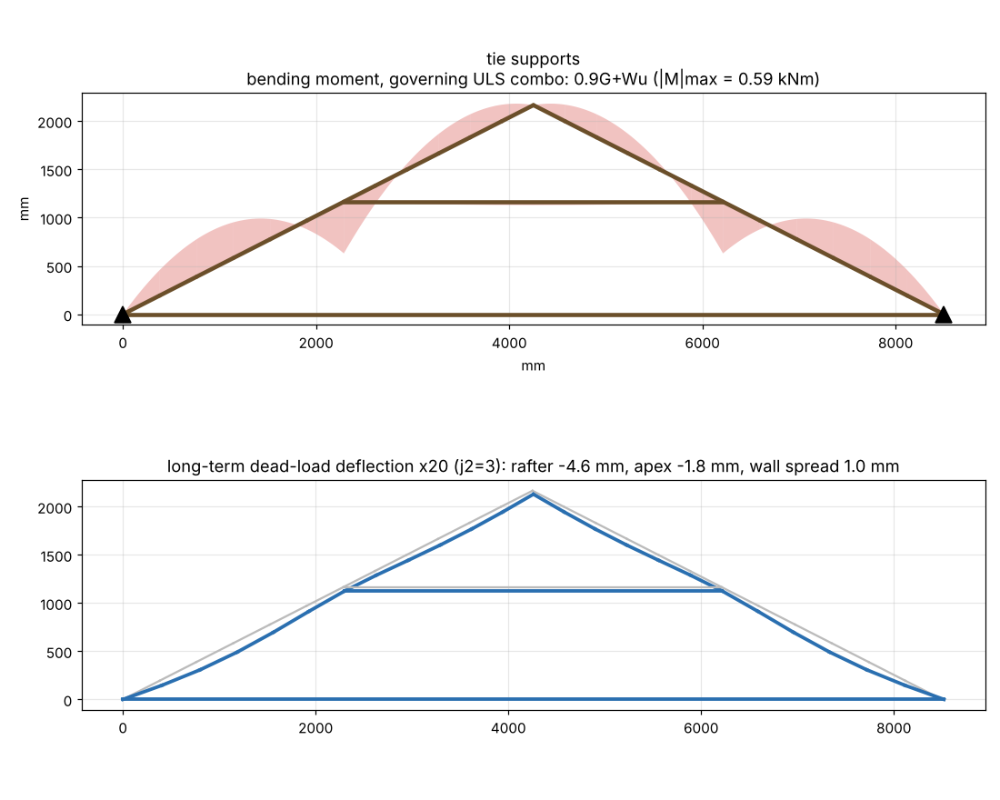
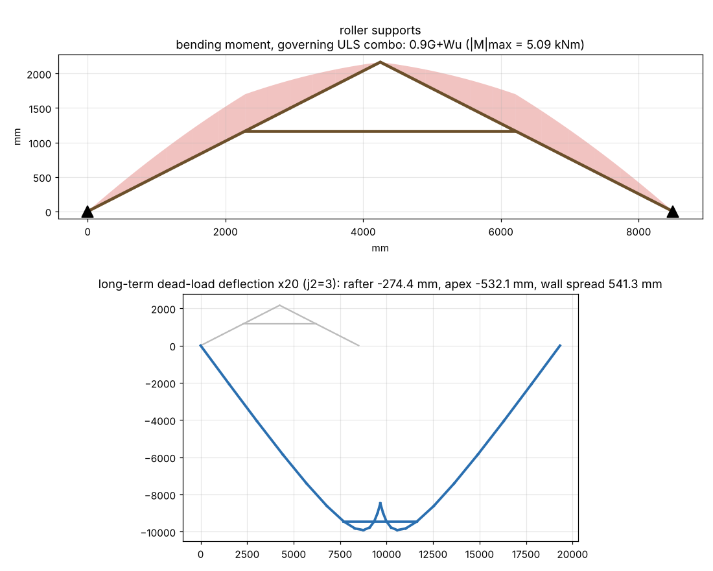
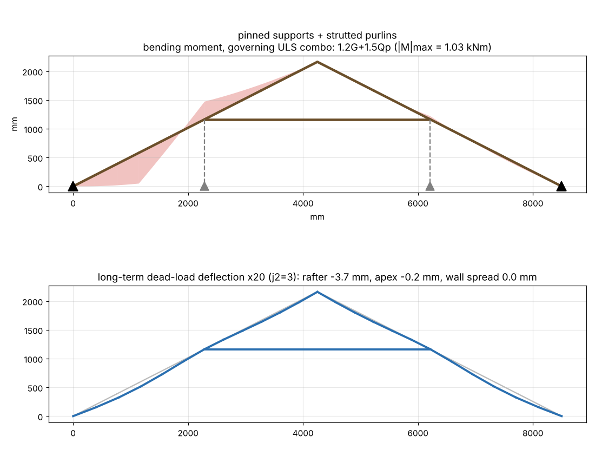
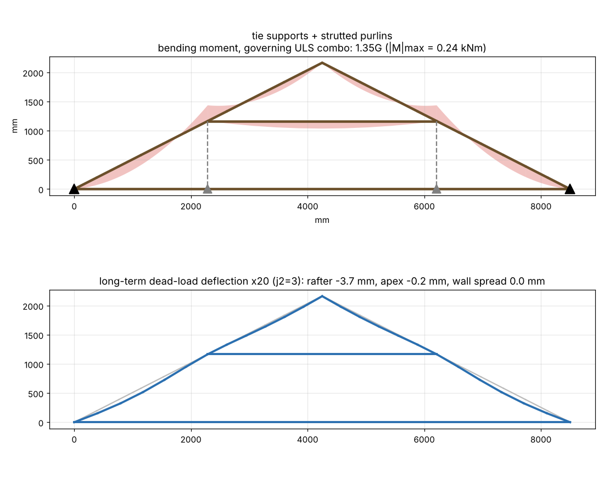

# Roof truss analysis — span 8500 mm, pitch 27°, 35x105 F7 Oregon, trusses @ 1200 c/c

Geometry: rise 2165 mm, rafter 4770 mm on slope (wall→collar 2567, collar→apex 2203), collar tie 3925 mm long at 1165 mm above the plate.

### pinned supports — 35x105 F7, span 8500, pitch 27°, trusses @ 1200 c/c

Governing utilisation per member (ULS, demand/capacity; >1.0 = FAIL):

| group | combo | tag | util | M* kNm | Md kNm | N* kN | Ncx kN | Ncy kN | Nt kN | k12b | k12cy |
|---|---|---|---|---|---|---|---|---|---|---|---|
| rafter | 1.2G+Wa | rafter R lower | 12.74 | -2.21 | 0.62 | -1.01 | 14.32 | 12.95 | 28.30 | 0.76 | 0.39 |
| collar | 1.2G+Wd | collar tie | 8.52 | 0.05 | 0.48 | -5.79 | 6.13 | 0.68 | 28.30 | 0.59 | 0.02 |

Support reactions per truss (kN; H = horizontal thrust the wall must resist):

| support | |H| max | V max (down) | V min (uplift if <0) |
|---|---|---|---|
| wall L | 5.73 | 3.91 | -3.44 |
| wall R | 5.73 | 3.91 | -3.44 |

Serviceability deflections (mm; rafter limit span/300 = 15.9 mm on the 4770 mm slope length, lower segment 8.6 mm):

| case | j2 | rafter_mm | lower_seg_mm | apex_mm | spread_mm | collar_shorten_mm | collar_sag_mm | tie_sag_mm |
|---|---|---|---|---|---|---|---|---|
| G long-term | 3 | -4.20 | -3.89 | -0.85 | 0.00 | -0.36 | -6.89 | 0.00 |
| 0.7Q short-term | 1 | -1.86 | -1.73 | -0.36 | 0.00 | -0.15 | 0.00 | 0.00 |
| Ws uplift | 1 | 4.46 | 4.17 | 0.68 | 0.00 | 0.36 | 0.00 | 0.00 |

Collar-tie lap connection: N* = 5.79 kN (compression, 1.2G+Wd). With 3.15 mm nails in J4 Oregon (Q_k ≈ 0.515 kN, φ = 0.80, k1 = 1.0, k17 = 0.8) that is ≈ 18 nails each end; or design an M12 bolt + washers.

### tie supports — 35x105 F7, span 8500, pitch 27°, trusses @ 1200 c/c

Governing utilisation per member (ULS, demand/capacity; >1.0 = FAIL):

| group | combo | tag | util | M* kNm | Md kNm | N* kN | Ncx kN | Ncy kN | Nt kN | k12b | k12cy |
|---|---|---|---|---|---|---|---|---|---|---|---|
| tie | 0.9G+Wu | bottom tie | 34.03 | 0.16 | 0.23 | -4.87 | 1.31 | 0.15 | 28.30 | 0.28 | 0.00 |
| rafter | 1.2G+Wa | rafter R lower | 12.70 | -2.20 | 0.62 | -1.01 | 14.32 | 12.95 | 28.30 | 0.76 | 0.39 |
| collar | 1.2G+Wd | collar tie | 8.49 | 0.05 | 0.48 | -5.77 | 6.13 | 0.68 | 28.30 | 0.59 | 0.02 |

Support reactions per truss (kN; H = horizontal thrust the wall must resist):

| support | |H| max | V max (down) | V min (uplift if <0) |
|---|---|---|---|
| wall L | 3.38 | 4.01 | -3.37 |
| wall R | 0.00 | 4.01 | -3.37 |

Serviceability deflections (mm; rafter limit span/300 = 15.9 mm on the 4770 mm slope length, lower segment 8.6 mm):

| case | j2 | rafter_mm | lower_seg_mm | apex_mm | spread_mm | collar_shorten_mm | collar_sag_mm | tie_sag_mm |
|---|---|---|---|---|---|---|---|---|
| G long-term | 3 | -4.56 | -3.99 | -1.80 | 0.97 | -0.36 | -6.89 | -151.58 |
| 0.7Q short-term | 1 | -2.00 | -1.77 | -0.75 | 0.40 | -0.15 | 0.00 | 0.00 |
| Ws uplift | 1 | 4.73 | 4.25 | 1.39 | -0.72 | 0.36 | 0.00 | 0.00 |

Collar-tie lap connection: N* = 5.77 kN (compression, 1.2G+Wd). With 3.15 mm nails in J4 Oregon (Q_k ≈ 0.515 kN, φ = 0.80, k1 = 1.0, k17 = 0.8) that is ≈ 18 nails each end; or design an M12 bolt + washers.

### roller supports — 35x105 F7, span 8500, pitch 27°, trusses @ 1200 c/c

Governing utilisation per member (ULS, demand/capacity; >1.0 = FAIL):

| group | combo | tag | util | M* kNm | Md kNm | N* kN | Ncx kN | Ncy kN | Nt kN | k12b | k12cy |
|---|---|---|---|---|---|---|---|---|---|---|---|
| rafter | 0.9G+Wu | rafter R lower | 67.34 | -5.09 | 0.62 | 1.71 | 14.32 | 12.95 | 28.30 | 0.76 | 0.39 |
| collar | 0.9G+Wu | collar tie | 7.44 | 0.03 | 0.48 | -5.06 | 6.13 | 0.68 | 28.30 | 0.59 | 0.02 |

Support reactions per truss (kN; H = horizontal thrust the wall must resist):

| support | |H| max | V max (down) | V min (uplift if <0) |
|---|---|---|---|
| wall L | 3.38 | 3.91 | -3.44 |
| wall R | 0.00 | 3.91 | -3.44 |

Serviceability deflections (mm; rafter limit span/300 = 15.9 mm on the 4770 mm slope length, lower segment 8.6 mm):

| case | j2 | rafter_mm | lower_seg_mm | apex_mm | spread_mm | collar_shorten_mm | collar_sag_mm | tie_sag_mm |
|---|---|---|---|---|---|---|---|---|
| G long-term | 3 | -274.37 | -63.71 | -532.07 | 541.35 | 0.61 | -6.89 | 0.00 |
| 0.7Q short-term | 1 | -113.96 | -26.58 | -221.02 | 224.87 | 0.26 | 0.00 | 0.00 |
| Ws uplift | 1 | 203.71 | 48.56 | 394.88 | -401.71 | -0.36 | 0.00 | 0.00 |

Collar-tie lap connection: N* = 6.62 kN (tension, 1.2G+Wd). With 3.15 mm nails in J4 Oregon (Q_k ≈ 0.515 kN, φ = 0.80, k1 = 1.0, k17 = 0.8) that is ≈ 21 nails each end; or design an M12 bolt + washers.

### pinned supports + strutted purlins — 35x105 F7, span 8500, pitch 27°, trusses @ 1200 c/c

Governing utilisation per member (ULS, demand/capacity; >1.0 = FAIL):

| group | combo | tag | util | M* kNm | Md kNm | N* kN | Ncx kN | Ncy kN | Nt kN | k12b | k12cy |
|---|---|---|---|---|---|---|---|---|---|---|---|
| rafter | 1.2G+1.5Qp | rafter L lower | 1.76 | 1.03 | 0.79 | -0.41 | 9.27 | 8.38 | 27.45 | 1.00 | 0.26 |
| collar | 1.35G | collar tie | 0.23 | 0.05 | 0.24 | 0.16 | 2.33 | 0.26 | 16.13 | 0.51 | 0.01 |

Support reactions per truss (kN; H = horizontal thrust the wall must resist):

| support | |H| max | V max (down) | V min (uplift if <0) |
|---|---|---|---|
| strut L | 0.00 | 3.04 | -2.76 |
| strut R | 0.00 | 3.04 | -2.76 |
| wall L | 1.53 | 1.03 | -0.69 |
| wall R | 1.88 | 0.86 | -0.69 |

Serviceability deflections (mm; rafter limit span/300 = 15.9 mm on the 4770 mm slope length, lower segment 8.6 mm):

| case | j2 | rafter_mm | lower_seg_mm | apex_mm | spread_mm | collar_shorten_mm | collar_sag_mm | tie_sag_mm |
|---|---|---|---|---|---|---|---|---|
| G long-term | 3 | -3.68 | -3.73 | -0.18 | 0.00 | 0.05 | -6.89 | 0.00 |
| 0.7Q short-term | 1 | -1.64 | -1.66 | -0.08 | 0.00 | 0.02 | 0.00 | 0.00 |
| Ws uplift | 1 | 4.01 | 4.03 | 0.10 | 0.00 | 0.00 | 0.00 | 0.00 |

Collar-tie lap connection: N* = 0.50 kN (tension, 1.2G+1.5Q). With 3.15 mm nails in J4 Oregon (Q_k ≈ 0.515 kN, φ = 0.80, k1 = 0.94, k17 = 1.0) that is ≈ 2 nails each end; or design an M12 bolt + washers.

### tie supports + strutted purlins — 35x105 F7, span 8500, pitch 27°, trusses @ 1200 c/c

Governing utilisation per member (ULS, demand/capacity; >1.0 = FAIL):

| group | combo | tag | util | M* kNm | Md kNm | N* kN | Ncx kN | Ncy kN | Nt kN | k12b | k12cy |
|---|---|---|---|---|---|---|---|---|---|---|---|
| tie | 1.35G | bottom tie | 4.92 | 0.24 | 0.11 | 0.07 | 0.50 | 0.06 | 16.13 | 0.24 | 0.00 |
| rafter | 1.2G+1.5Qp | rafter L lower | 1.76 | 1.03 | 0.79 | -0.39 | 9.27 | 8.38 | 27.45 | 1.00 | 0.26 |
| collar | 1.35G | collar tie | 0.23 | 0.05 | 0.24 | 0.22 | 2.33 | 0.26 | 16.13 | 0.51 | 0.01 |

Support reactions per truss (kN; H = horizontal thrust the wall must resist):

| support | |H| max | V max (down) | V min (uplift if <0) |
|---|---|---|---|
| strut L | 0.00 | 3.07 | -2.64 |
| strut R | 0.00 | 2.99 | -2.64 |
| wall L | 3.38 | 1.12 | -0.73 |
| wall R | 0.00 | 1.02 | -0.73 |

Serviceability deflections (mm; rafter limit span/300 = 15.9 mm on the 4770 mm slope length, lower segment 8.6 mm):

| case | j2 | rafter_mm | lower_seg_mm | apex_mm | spread_mm | collar_shorten_mm | collar_sag_mm | tie_sag_mm |
|---|---|---|---|---|---|---|---|---|
| G long-term | 3 | -3.67 | -3.73 | -0.19 | 0.04 | 0.07 | -6.89 | -151.58 |
| 0.7Q short-term | 1 | -1.64 | -1.66 | -0.09 | 0.02 | 0.03 | 0.00 | 0.00 |
| Ws uplift | 1 | 4.01 | 4.03 | 0.09 | 0.03 | 0.01 | 0.00 | 0.00 |

Collar-tie lap connection: N* = 0.99 kN (tension, 1.2G+Wa). With 3.15 mm nails in J4 Oregon (Q_k ≈ 0.515 kN, φ = 0.80, k1 = 1.0, k17 = 1.0) that is ≈ 3 nails each end; or design an M12 bolt + washers.

### Section sweep (walls resist thrust = pinned, purlins NOT strutted)

| section | rafter util | rafter combo | collar util | rafter δG mm | limit mm | H wall kN |
|---|---|---|---|---|---|---|
| 35x105 | 12.74 | 1.2G+Wa | 8.52 | 4.20 | 15.90 | 5.73 |
| 35x140 | 5.61 | 1.2G+Wa | 6.45 | 2.02 | 15.90 | 5.81 |
| 45x140 | 2.06 | 1.2G+Wa | 3.08 | 1.66 | 15.90 | 5.91 |
| 45x190 | 0.91 | 1.2G+Wa | 2.30 | 0.83 | 15.90 | 6.05 |
| 35x190 | 2.71 | 1.2G+Wa | 4.80 | 1.00 | 15.90 | 5.91 |
| 45x240 | 0.66 | 1.2G+Wa | 1.84 | 0.52 | 15.90 | 6.18 | 

### Section sweep (pinned + purlins strutted)

| section | rafter util | rafter combo | collar util | rafter δG mm | limit mm | H wall kN |
|---|---|---|---|---|---|---|
| 35x105 | 1.76 | 1.2G+1.5Qp | 0.23 | 3.68 | 15.90 | 1.88 |
| 35x140 | 0.79 | 1.2G+1.5Qp | 0.23 | 1.60 | 15.90 | 1.88 |
| 45x140 | 0.59 | 1.2G+1.5Qp | 0.14 | 1.31 | 15.90 | 1.89 |
| 45x190 | 0.32 | 1.2G+1.5Qp | 0.14 | 0.55 | 15.90 | 1.90 |
| 35x190 | 0.56 | 1.2G+1.5Qp | 0.22 | 0.66 | 15.90 | 1.89 |
| 45x240 | 0.22 | 1.2G+1.5Qp | 0.14 | 0.28 | 15.90 | 1.91 | 

